# Sorteador para Resolume

Plugin FFGL para o **Resolume Arena/Avenue 7** que faz sorteios de **nomes** ou **números** com animação e efeitos na tela. Você controla tudo pelo painel do Resolume ou por uma **página web**, aberta no celular, tablet ou em outro computador da mesma rede.

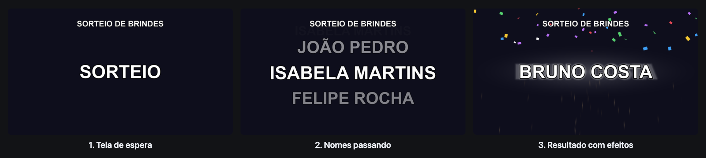

## Sumário

- [Recursos](#recursos)
- [Instalação](#instalação)
- [Primeiro sorteio em 5 minutos](#primeiro-sorteio-em-5-minutos)
- [O painel web](#o-painel-web)
- [O painel do Resolume](#o-painel-do-resolume)
- [Animações](#animações)
- [Efeitos no resultado](#efeitos-no-resultado)
- [Vários ganhadores e tela de ganhadores](#vários-ganhadores-e-tela-de-ganhadores)
- [Contagem, nomes longos e QR code](#contagem-nomes-longos-e-qr-code)
- [Sorteio de números](#sorteio-de-números)
- [Sorteio de teste (Ensaio)](#sorteio-de-teste-ensaio)
- [Canais](#canais)
- [Tutoriais](#tutoriais)
- [API HTTP (Stream Deck / Companion)](#api-http-stream-deck--companion)
- [Onde ficam os dados](#onde-ficam-os-dados)
- [Solução de problemas](#solução-de-problemas)
- [Compilando](#compilando)
- [Créditos](#créditos) · [Licença](#licença)

## Recursos

**O que sortear**

- Lista de nomes (um por linha) ou faixa de números, com opção de completar com zeros à esquerda (`007`)
- `Nome | detalhe` na lista mostra uma segunda linha sob o sorteado (cidade, número do cupom…)
- **Vários ganhadores por sorteio** (até 20), revelados um a um ou todos juntos em grade
- Opção de **não repetir** quem já saiu; o painel mostra quantos ainda estão disponíveis
- **Histórico** com data e horário de cada sorteado, salvo mesmo depois de fechar o Resolume. Dá para copiar a lista, remover um sorteado ou zerar tudo, com **desfazer**
- **Ausente, sortear de novo:** marca quem não está presente e já sorteia outro, sem apagar o registro

**Como aparece na tela**

- Cinco animações: **rolagem vertical** (com efeito tambor), **rolagem horizontal**, **troca no lugar**, **roda da fortuna** e **caça-níquel**
- Efeitos quando o nome para: **impacto, flash, onda de choque, faíscas, confete e brilho**, com intensidade de 20% a 200%
- **Contagem regressiva** "3, 2, 1" antes do giro e **tela de ganhadores** com todos os sorteados até agora
- Volta automática à tela de espera depois do resultado, com transição suave
- Fonte (qualquer fonte instalada no computador), tamanho, posição, contorno e cores; fundo transparente para sobrepor a outras camadas
- Título com fonte, tamanho, posição e cor próprios; texto de espera com tamanho e cor próprios; tudo em maiúsculas (com acentos), se quiser
- Texto nítido em qualquer resolução. Nomes longos quebram em duas linhas antes de encolher
- **Estilos prontos** (Clássico, Dourado, Neon, Minimalista, Bingo) e **Restaurar padrão** em cada aba

**Controle**

- **Painel web** responsivo, com palco que reproduz a saída com fidelidade (mesma fonte, animação e efeitos)
- Modos **Ensaio** e **Ao vivo**: a página fica azul ou vermelha, para deixar claro se o botão grande vai para o ar
- Aviso quando **nenhum clip** do canal está rodando no Resolume, antes de sortear para uma tela vazia
- **Travar configurações** para operar o evento sem mexer em nada por engano
- **QR code** na tela de espera para abrir o painel no celular
- Avisos na lista: nomes repetidos, a mesma pessoa escrita de jeitos diferentes e nomes longos demais
- Todos os ajustes também como **parâmetros do clip** no Resolume, mapeáveis para MIDI, OSC e teclado, sempre sincronizados com o painel web
- Até **4 canais** independentes, cada um com seu **nome** ("Brindes", "Rifa"), para sorteios diferentes ao mesmo tempo
- **Exportar e importar** a configuração de um canal, e **copiar o visual** de um canal para outro
- **API HTTP** para Stream Deck, Bitfocus Companion ou qualquer aparelho que faça uma requisição web

## Instalação

### Windows

1. Baixe o `Sorteador.dll` na página de [Releases](https://github.com/osamuelvieira/sorteador-resolume/releases). Se ainda não houver uma release, baixe o artefato **Sorteador-Windows** da última execução em [Actions](https://github.com/osamuelvieira/sorteador-resolume/actions).
2. Copie o arquivo para `Documentos\Resolume Arena\Extra Effects` (ou para a pasta de plugins configurada em *Preferences → Video*).
3. Reinicie o Resolume.
4. Na aba **Sources**, procure por **Sorteador** e arraste para um clip.
5. Na primeira vez, o Windows pode perguntar se o Resolume pode usar a rede. **Permita em redes privadas**, senão o painel web não abre em outros aparelhos.

### macOS

1. Baixe o `Sorteador-macOS.zip` (ou o artefato **Sorteador-macOS**), extraia e copie o `Sorteador.bundle` para `~/Documents/Resolume Arena/Extra Effects`.
2. Siga os passos 3 e 4 do Windows.
3. Se o Sorteador não aparecer, ou o macOS disser que não pode verificar o desenvolvedor, o arquivo ficou marcado como baixado da internet. Rode no Terminal e reinicie o Resolume:

   ```bash
   xattr -dr com.apple.quarantine ~/Documents/Resolume\ Arena/Extra\ Effects/Sorteador.bundle
   ```

## Primeiro sorteio em 5 minutos

1. **Coloque o plugin num clip.** Na aba *Sources* do Resolume, arraste **Sorteador** para um clip vazio e dispare o clip. A saída mostra o texto de espera, `SORTEIO`.
2. **Abra o painel web.** Nos parâmetros do clip, clique em **Abrir painel web**. O navegador abre direto no canal desse clip.
3. **Cole a lista.** Na aba **Conteúdo**, deixe **Lista de nomes** selecionado e cole os nomes, um por linha (dá para copiar uma coluna do Excel ou do Google Planilhas).
4. **Dê um título.** Na aba **Textos**, escreva o título, por exemplo `Sorteio de brindes`. O palco à esquerda já mostra como fica.
5. **Sorteie.** Confira que o topo está em **Ao vivo** (vermelho) e clique em **Iniciar sorteio**, ou **segure** a barra de espaço. O nome sorteado vai para o *Histórico* com data e horário.
6. Para voltar à tela de espera, clique em **Limpar tela**.

| Sorteando | Resultado |
|---|---|
| 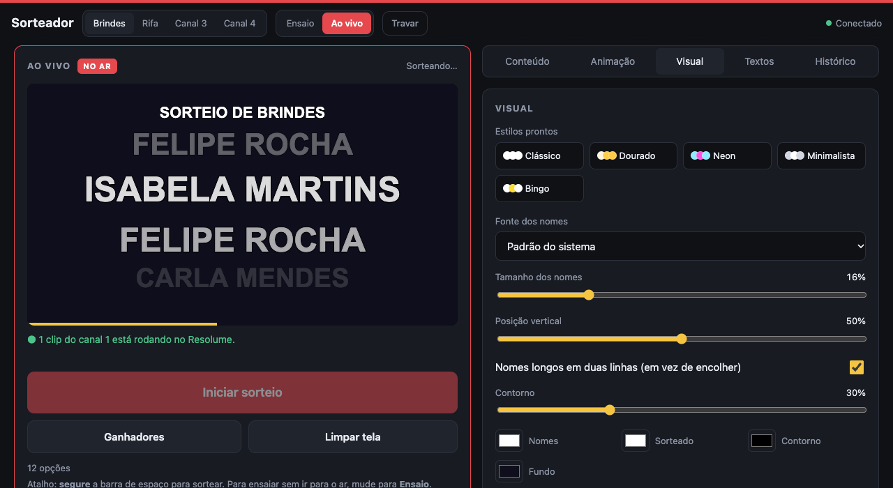 | 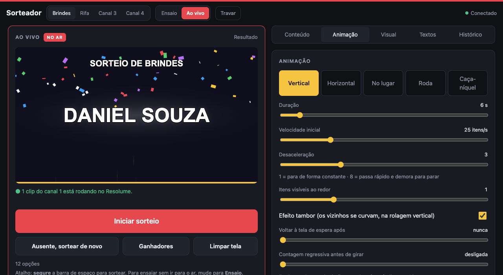 |

## O painel web

Abra pelo botão **Abrir painel web** no clip, pelo [QR code da tela de espera](#controlar-pelo-celular), ou digite o endereço do computador do Resolume em qualquer navegador da mesma rede (por exemplo `http://192.168.0.10:8090`).

No computador, o **palco** fica fixo à esquerda e as configurações em abas à direita, para ver cada ajuste enquanto mexe. No celular, o palco fica em cima e as abas embaixo.

<p align="center">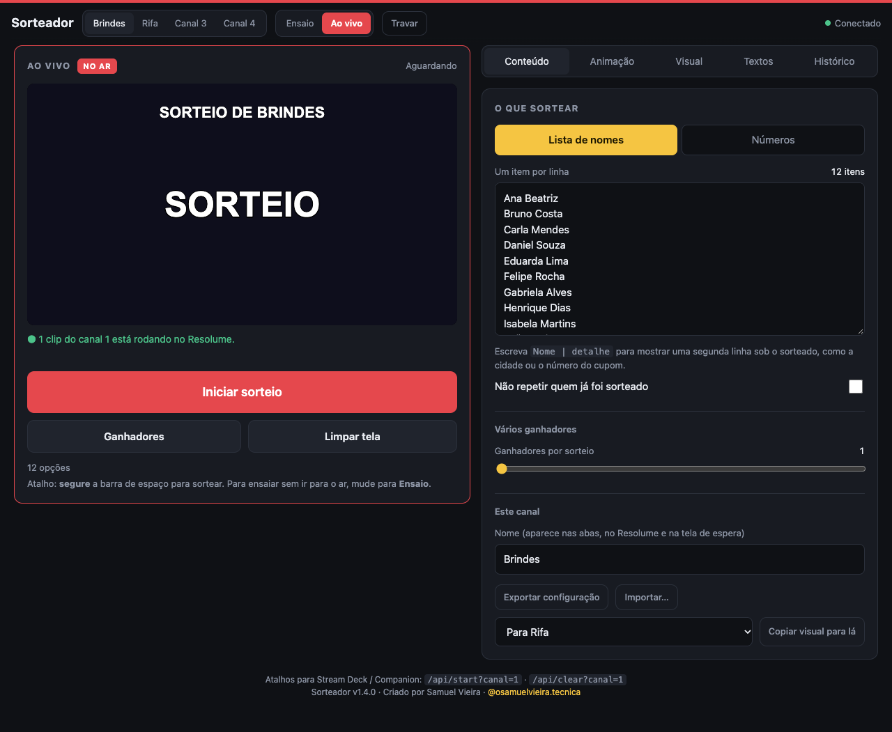</p>

| Parte | O que tem |
|---|---|
| **Canais** (topo) | Troca entre os canais 1 a 4, com os nomes dados a eles. O indicador à direita mostra se o painel está conectado ao plugin |
| **Ensaio / Ao vivo** (topo) | Define o que o botão grande faz. Em **Ao vivo** (vermelho, *NO AR*) ele sorteia de verdade; em **Ensaio** (azul) faz um [sorteio de teste](#sorteio-de-teste-ensaio). O navegador lembra a escolha |
| **Travar** (topo) | Trava as configurações do canal em todos os painéis ([veja abaixo](#travar-configurações)) |
| **Palco** | Reprodução fiel da saída (ou do teste, em Ensaio), com barra de progresso e estado. Embaixo, quantos clips do canal estão rodando no Resolume, com aviso se nenhum estiver. Botões **Iniciar sorteio**, **Ausente, sortear de novo**, **Ganhadores** e **Limpar tela**, e quantos ainda estão disponíveis |
| Aba **Conteúdo** | Lista de nomes ou faixa de números, *Completar com zeros* e *Não repetir*, com avisos sobre nomes repetidos, parecidos ou longos demais. **Vários ganhadores**. **Este canal**: nome, exportar, importar e copiar o visual para outro canal |
| Aba **Animação** | Tipo de animação, duração, velocidade inicial, desaceleração, itens visíveis ao redor, efeito tambor, volta automática à espera, contagem regressiva e os efeitos |
| Aba **Visual** | Estilos prontos, fonte, tamanho, posição vertical, nomes longos em duas linhas, contorno, cores e opacidade do fundo |
| Aba **Textos** | Título (texto, fonte, tamanho, posição e cor), texto de espera (texto, tamanho e cor), título da tela de ganhadores, maiúsculas e QR code na tela de espera |
| Aba **Histórico** | Ordem, nome, data e horário de cada sorteado; ausentes aparecem riscados. **×** remove um item, **Copiar lista** copia tudo com os horários, **Zerar histórico** libera todos de novo (dá para desfazer logo em seguida) |

As mudanças aparecem na saída na hora, sem precisar salvar. O painel lembra o último canal e a última aba usados, e o endereço `/?canal=2` abre direto no canal 2.

**Estilos prontos e Restaurar padrão.** Na aba *Visual*, os estilos prontos trocam cores e efeitos de uma vez. As abas *Animação*, *Visual* e *Textos* têm **Restaurar padrão** no fim, que só mexe no estilo daquela aba. Nenhum dos dois toca na lista ou nos textos escritos, e os dois podem ser desfeitos pelo aviso que aparece embaixo.

**Barra de espaço.** Em *Ensaio*, um toque faz o sorteio de teste. Em *Ao vivo*, é preciso **segurar** por meio segundo (o botão vai enchendo), para que uma tecla apertada sem querer não sorteie no ar.

### Ausente, sortear de novo

Quando o sorteado não está presente, clique em **Ausente, sortear de novo** e confirme no segundo clique. O nome fica no histórico **riscado, marcado como ausente** (e continua contando como sorteado, então não volta a sair), e um novo sorteio começa na hora. O botão aparece só com um resultado de um ganhador na tela. Também existe como parâmetro do clip, para mapear em MIDI ou teclado.

Se quiser devolver a pessoa ao sorteio, remova a linha dela no histórico com o **×**.

### Travar configurações

Antes do evento começar, clique em **Travar**. Em todos os painéis abertos naquele canal (celular, tablet, notebook), as abas de configuração e o *Zerar histórico* somem; ficam só o palco, os botões de sorteio e o histórico. A trava fica salva até alguém clicar em **Destravar**. Os parâmetros do clip no Resolume continuam funcionando normalmente.

## O painel do Resolume

Os mesmos ajustes aparecem como parâmetros do clip. Painel web e Resolume mostram sempre os mesmos valores: o que você muda em um aparece no outro.

| Parâmetro | O que faz |
|---|---|
| **Iniciar sorteio** | Começa a animação e sorteia |
| **Limpar tela** | Volta para o texto de espera |
| **Zerar histórico** | Todos voltam a poder ser sorteados |
| **Ausente, sortear de novo** | Marca o sorteado na tela como ausente e sorteia outro (num clip em modo prévia, só repete o teste) |
| **Mostrar ganhadores** | Mostra a [tela de ganhadores](#tela-de-ganhadores) |
| **Abrir painel web** | Abre o painel no navegador do computador do Resolume, já no canal deste clip |
| **Canal** | Qual sorteio este clip mostra. As opções mostram o nome dado no painel web, como "1 · Brindes" |
| **Tipo** | Lista de nomes ou Números |
| **Lista (separe com ;)** | Edição rápida da lista em uma linha: `Ana; Bruno; Carla` |

E nos grupos:

- **Sorteio:** número inicial e final, não repetir, *Modo prévia (teste)*, ganhadores por sorteio, revelar ganhadores (um a um ou em grade) e o intervalo entre eles
- **Animação:** animação, duração, velocidade inicial, desaceleração, itens ao redor, efeito tambor, voltar à espera após, contagem regressiva, os seis efeitos e a intensidade
- **Visual:** tamanho e posição dos nomes, cores (texto, sorteado, contorno, fundo), contorno, opacidade do fundo, nomes longos em 2 linhas, título (texto, tamanho, posição e cor), texto de espera (texto, tamanho e cor), título dos ganhadores, letras maiúsculas e mostrar endereço web

As fontes (dos nomes e do título) só podem ser escolhidas no painel web.

Os botões e os demais parâmetros podem ser mapeados para **MIDI, OSC ou teclado** como qualquer parâmetro do Resolume (clique com o botão direito no parâmetro ou use o modo de mapeamento).

## Animações

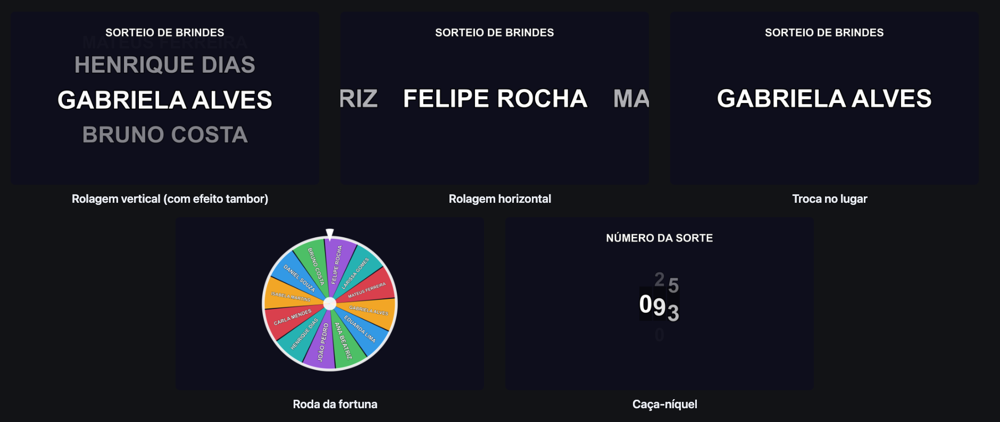

| Animação | Como é |
|---|---|
| **Rolagem vertical** | Os nomes descem como numa roleta, com os vizinhos acima e abaixo em tom mais apagado. Com o **efeito tambor**, eles se curvam e diminuem nas bordas |
| **Rolagem horizontal** | Os nomes passam da direita para a esquerda, como um letreiro |
| **Troca no lugar** | Um nome por vez no centro, trocando cada vez mais devagar |
| **Roda da fortuna** | Uma roda colorida com até 16 fatias gira e para com o sorteado embaixo do ponteiro; depois ela esmaece e o nome aparece grande na frente. Com muitos nomes, cada giro mostra o sorteado e outros 15 da lista |
| **Caça-níquel** | Cada caractere gira na sua própria janela e eles param um depois do outro, da esquerda para a direita. Feito para números (bingo, rifa, cupom), mas funciona com nomes |

Ajustes que valem para todas:

- **Duração:** de 1 a 60 segundos
- **Velocidade inicial:** quantos itens passam por segundo no começo (2 a 100)
- **Desaceleração:** de 1 a 8. Em 1 a velocidade cai de forma constante; em 8 os nomes passam rápido por mais tempo e demoram a parar, o que dá mais suspense
- **Itens visíveis ao redor:** de 0 a 4 vizinhos de cada lado (só nas rolagens)
- **Voltar à tela de espera após:** de 1 a 60 segundos depois do resultado o nome some suavemente e o texto de espera volta. Em *nunca* (o padrão), o resultado fica até você clicar em **Limpar tela**
- **Contagem regressiva:** de 1 a 5 segundos de "3, 2, 1" antes de começar a girar

O sorteado é escolhido no instante em que o sorteio começa, de forma aleatória e uniforme; a animação só mostra o caminho até ele.

## Efeitos no resultado

Para o público perceber na hora que o sorteio terminou, o plugin pode disparar efeitos quando o nome para:

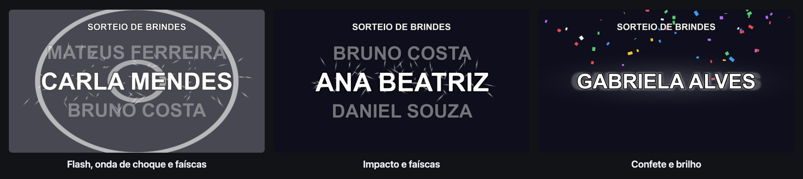

| Efeito | O que faz | Padrão |
|---|---|---|
| **Impacto** | O nome dá um "soco" de zoom e a tela treme por um instante | ligado |
| **Flash** | Clarão rápido na tela inteira | ligado |
| **Onda de choque** | Anéis que se expandem a partir do nome | desligado |
| **Faíscas** | Faíscas saem do nome | ligado |
| **Confete** | Chuva de confete colorido por alguns segundos | desligado |
| **Brilho** | Halo pulsando em volta do nome enquanto ele fica na tela | desligado |

**Intensidade** (20% a 200%) aumenta ou diminui todos de uma vez: quantidade de partículas, força do flash e do tremor. Os efeitos ficam no grupo *Animação* do clip e na aba *Animação* do painel web.

## Vários ganhadores e tela de ganhadores

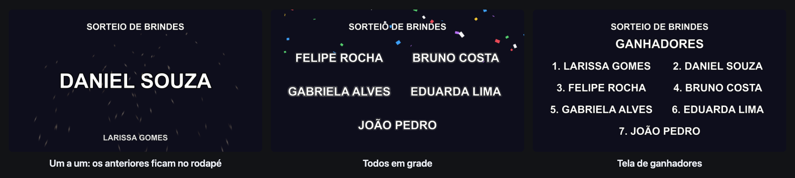

### Vários ganhadores

Em *Conteúdo → Vários ganhadores*, escolha quantos ganhadores cada sorteio tem (até 20). Num mesmo sorteio nunca sai o mesmo nome (ou número) duas vezes, e cada um entra no histórico na hora em que aparece. Se restarem menos disponíveis que o pedido, o sorteio usa os que restam e avisa.

- **Um a um:** cada ganhador tem seu próprio giro, com a animação escolhida (inclusive roda e caça-níquel), e fica sozinho na tela pelo *tempo de cada ganhador*. Os anteriores ficam numa linha no rodapé, e no fim todos aparecem juntos em grade.
- **Todos em grade:** todos giram ao mesmo tempo, cada um na sua posição, e param um depois do outro. Os efeitos tocam quando o último para.

**Ausente, sortear de novo** só funciona em sorteios de um ganhador; com vários, use o **×** no histórico.

### Tela de ganhadores

O botão **Ganhadores** (ou o parâmetro *Mostrar ganhadores*) coloca na saída todos os sorteados até agora, numerados, com o título escolhido na aba *Textos* (padrão: "Ganhadores"). Ausentes não aparecem. Ela fica até você clicar em **Limpar tela** ou começar outro sorteio.

## Contagem, nomes longos e QR code

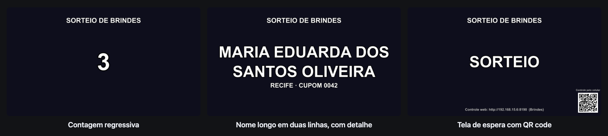

**Contagem regressiva.** Na aba *Animação*, escolha de 1 a 5 segundos. Cada número aparece grande e encolhe antes do giro começar.

**Nomes longos em duas linhas.** Com essa opção ligada (aba *Visual*), um nome que não cabe na largura da tela quebra em duas linhas no resultado e na tela de espera, em vez de ficar minúsculo. Durante o giro os nomes continuam em uma linha.

**Segunda linha com detalhe.** Na lista, escreva `Nome | detalhe` para mostrar uma linha menor sob o sorteado:

```
Maria Eduarda dos Santos Oliveira | Recife · cupom 0042
Bruno Costa | Caruaru
Carla Mendes
```

A roleta mostra só os nomes; o detalhe aparece com o resultado, e o histórico guarda a linha inteira.

**QR code.** Com *Mostrar QR code e endereço deste painel na tela de espera* ligado (aba *Textos*), a tela de espera mostra um QR code no canto e o endereço no rodapé. Veja [Controlar pelo celular](#controlar-pelo-celular).

## Sorteio de números

Na aba *Conteúdo*, escolha **Números** e defina o número inicial e o final (podem ser negativos). Ligue **Completar com zeros** para que todos tenham a mesma quantidade de dígitos: de 1 a 500, o 47 aparece como `047`. Para bingo e rifa, a animação **Caça-níquel** faz cada dígito parar de uma vez.

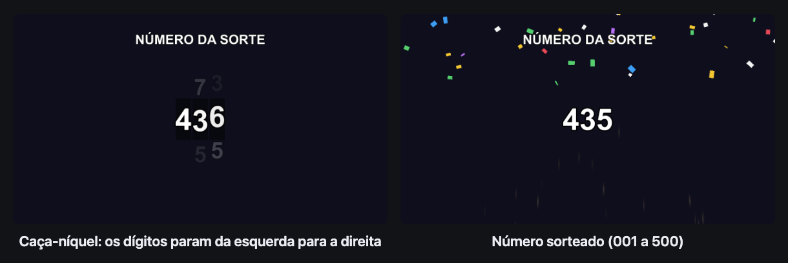

Com *Não repetir* ligado, cada número sai uma vez só até você zerar o histórico.

## Sorteio de teste (Ensaio)

Serve para ensaiar a animação e os efeitos antes do evento, ou conferir um ajuste durante ele, **sem ir para o ar**:

- o teste roda a animação e os efeitos completos, mas **não entra no histórico** e não tira ninguém da lista
- ele aparece **só nos clips com _Modo prévia (teste)_ ligado**. Os clips normais continuam mostrando o sorteio de verdade, então a saída não muda
- num clip em modo prévia, os botões *Iniciar sorteio*, *Limpar tela* e *Mostrar ganhadores* passam a valer para o teste, e um aviso **PRÉVIA - TESTE** aparece no canto

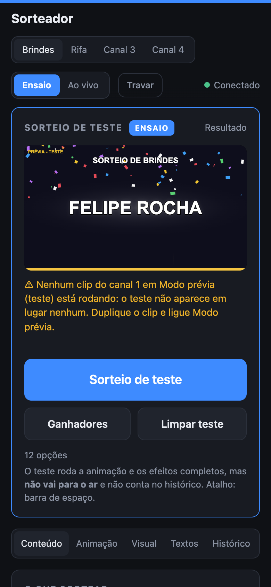

No painel web, mude o topo para **Ensaio**: a página fica azul, o palco passa a mostrar o teste exatamente como o clip de prévia mostra, e o botão grande vira **Sorteio de teste**. Se nenhum clip em modo prévia estiver rodando, o painel avisa, como na imagem ao lado.

O passo a passo para montar está no [tutorial de ensaio](#ensaiar-sem-ir-para-o-ar).

<br clear="right">

## Canais

Cada canal tem sua própria lista, configuração e histórico.

- Clips no **mesmo canal** mostram exatamente o mesmo sorteio, em sincronia. Útil para exibir em mais de uma camada ou saída (por exemplo, telão e monitor de retorno)
- Para dois sorteios diferentes ao mesmo tempo, coloque os clips em **canais diferentes**
- **Dê um nome** ao canal em *Conteúdo → Este canal*. Ele aparece nas abas do painel, no parâmetro *Canal* do Resolume e na tela de espera
- **Exportar configuração** baixa um arquivo com a lista e todas as configurações do canal; **Importar…** carrega esse arquivo em qualquer canal, inclusive em outro computador (se a fonte não existir lá, usa a padrão)
- **Copiar visual para lá** leva animação, efeitos, cores, fontes e tamanhos para outro canal, sem mexer na lista nem nos textos

## Tutoriais

### Sorteio de brindes num evento

1. Monte a lista no Excel ou Google Planilhas, uma pessoa por linha, e cole na aba *Conteúdo*. Se quiser mostrar a cidade ou o número do cupom, use `Nome | detalhe`.
2. Deixe **Não repetir quem já foi sorteado** ligado, para ninguém ganhar duas vezes.
3. Escolha a animação. Para suspense, **Rolagem vertical**, duração de 8 a 10 s e desaceleração 4 ou 5; para algo mais festivo, a **Roda da fortuna**. Uma **contagem regressiva** de 3 s ajuda a chamar a atenção do público.
4. Escolha um estilo pronto, como **Dourado**, ou ligue os efeitos que combinam com o evento, por exemplo **Confete** e **Brilho**.
5. Ensaie com o [sorteio de teste](#ensaiar-sem-ir-para-o-ar) antes de abrir as portas.
6. Na hora, deixe o painel em **Ao vivo** e clique em **Travar**, para ninguém mudar a lista ou o visual por engano.
7. Use **Iniciar sorteio** para cada brinde e **Limpar tela** entre um e outro (ou ligue *Voltar à tela de espera após* para isso acontecer sozinho).
8. Se o sorteado não estiver presente, use **Ausente, sortear de novo**: o nome fica marcado no histórico e outro é sorteado na hora.
9. No fim, mostre a **tela de ganhadores** e use **Copiar lista** para guardar todos os sorteados com data e horário (e quem estava ausente), para conferência ou ata.

### Vários prêmios de uma vez

Para sortear, por exemplo, 5 kits iguais:

1. Em *Conteúdo → Vários ganhadores*, coloque **5** ganhadores por sorteio.
2. Escolha **Um a um** para dar a cada ganhador seu momento (com o tempo de cada um sozinho na tela), ou **Todos em grade** para revelar todos de uma vez.
3. Clique em **Iniciar sorteio** uma vez só. Os 5 entram no histórico conforme aparecem.

### Sobrepor o sorteio a um vídeo

Com **Opacidade do fundo** em 0 (o padrão), só o texto e os efeitos aparecem, e as camadas de baixo continuam visíveis. Coloque o clip do Sorteador numa camada acima do seu vídeo ou arte de fundo.

<p align="center">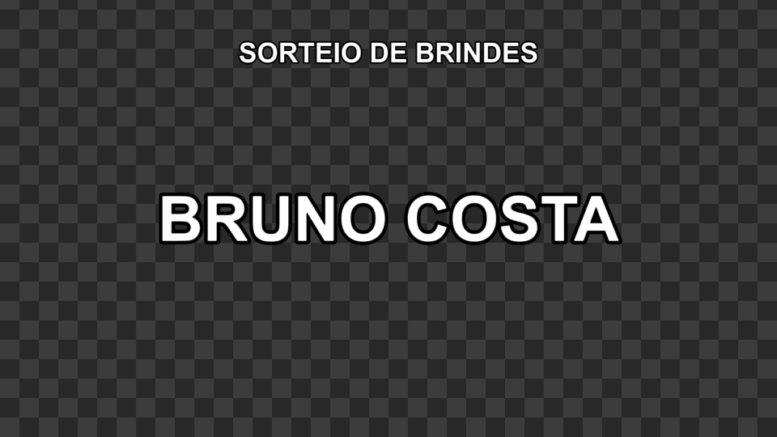</p>

Para destacar o texto sobre fundos claros, aumente o **Contorno** ou ligue o **Brilho**. Se preferir um fundo sólido, escolha a **Cor do fundo** e suba a **Opacidade do fundo**.

### Controlar pelo celular

1. Na aba *Textos*, ligue **Mostrar QR code e endereço deste painel na tela de espera**. A saída passa a mostrar um **QR code** no canto e, no rodapé, algo como `Controle web: http://192.168.0.10:8090 (Brindes)`.
2. Conecte o celular **na mesma rede Wi-Fi** do computador do Resolume.
3. Aponte a câmera do celular para o QR code: o painel abre direto no canal daquele clip. Dica: adicione à tela de início para abrir como um app.
4. Desligue a opção de novo antes de ir para o ar.

Se não abrir, veja [Solução de problemas](#solução-de-problemas).

### Ensaiar sem ir para o ar

1. Duplique o clip do sorteio (no mesmo canal).
2. Na cópia, ligue **Modo prévia (teste)**.
3. Deixe a cópia fora da saída: por exemplo, veja pelo monitor de **Preview** do Resolume, ou ponha numa camada enviada só para o monitor do operador (*Advanced Output*).
4. No painel web, mude para **Ensaio** e clique em **Sorteio de teste** (ou em *Iniciar sorteio* no clip de prévia).
5. Ajuste animação e efeitos até ficar bom. Os ajustes valem para o sorteio de verdade, mas o teste não conta no histórico.
6. Volte para **Ao vivo** antes do evento.

### Dois sorteios ao mesmo tempo

Por exemplo, um sorteio de nomes no telão principal e um de números da rifa num telão lateral:

1. No painel web, dê nome aos canais: *Brindes* no canal 1 e *Rifa* no canal 2 (*Conteúdo → Este canal*).
2. Crie um clip do Sorteador na camada do telão principal com **Canal** = *1 · Brindes*.
3. Crie outro clip na camada do telão lateral com **Canal** = *2 · Rifa*.
4. Use as abas **Brindes** e **Rifa** do painel para configurar cada um. Listas, visuais e históricos são separados. Para os dois terem o mesmo visual, use **Copiar visual para lá**.

### Levar a configuração para outro computador

1. No computador de origem, clique em **Exportar configuração** em *Conteúdo → Este canal*.
2. No outro computador, abra o painel, escolha o canal e clique em **Importar…** com o arquivo baixado.

Para levar todos os canais e o histórico de uma vez, copie o arquivo de [dados](#onde-ficam-os-dados).

### Stream Deck e Bitfocus Companion

**Companion:** adicione uma conexão **Generic HTTP** e crie botões com a ação *GET* para os endereços da [API](#api-http-stream-deck--companion), por exemplo `http://192.168.0.10:8090/api/start?canal=1`.

**Stream Deck:** use um plugin de requisição web (como *API Ninja* ou *Web Requests*) com os mesmos endereços.

Sugestão de botões: *Sortear*, *Ausente*, *Ganhadores*, *Limpar tela*, *Teste* e *Limpar teste*.

## API HTTP (Stream Deck / Companion)

Todas as rotas aceitam `GET` ou `POST` e o parâmetro `canal` (1 a 4, padrão 1). As ações respondem com o estado atual do canal em JSON.

| Rota | O que faz |
|---|---|
| `/api/start?canal=1` | Inicia o sorteio |
| `/api/clear?canal=1` | Limpa a tela (volta para o texto de espera) |
| `/api/redraw?canal=1` | Marca o sorteado na tela como ausente e sorteia de novo |
| `/api/board?canal=1` | Mostra a tela de ganhadores |
| `/api/test?canal=1` | Sorteio de teste (só nos clips em modo prévia) |
| `/api/test/clear?canal=1` | Limpa o teste |
| `/api/test/board?canal=1` | Tela de ganhadores só nos clips em modo prévia |
| `/api/reset-history?canal=1` | Zera o histórico (não funciona com o canal travado) |
| `/api/history/undo-reset?canal=1` | Desfaz o último *Zerar histórico*, se ninguém foi sorteado depois |
| `/api/history/remove?canal=1&index=0` | Remove um sorteado do histórico (`index` começa em 0) |
| `/api/lock?canal=1&on=1` | Trava (`on=1`) ou destrava (`on=0`) as configurações do canal |
| `/api/rename?canal=1&nome=Brindes` | Dá nome ao canal (`nome` vazio volta a "Canal 1") |
| `/api/state?canal=1` | Estado atual: fase, sorteado, histórico, disponíveis, configuração, trava, nomes dos canais e clips rodando (`outputs`) |
| `/api/qr?canal=1` | O QR code da tela de espera |
| `/api/fonts` | Fontes instaladas no computador |
| `/api/defaults` | Configuração padrão |

Para mudar configurações, envie `POST /api/config?canal=1` com um JSON parcial. Só as chaves enviadas mudam (com o canal travado, a resposta é `423`):

```bash
curl -X POST "http://192.168.0.10:8090/api/config?canal=1" \
  -H "Content-Type: application/json" \
  -d '{"title": "Sorteio de brindes", "duration": 10, "animation": 3, "fxConfetti": true}'
```

| Chave | Valores |
|---|---|
| `mode` | `0` lista de nomes, `1` números |
| `listText` | Nomes separados por quebra de linha (`\n`); `Nome \| detalhe` mostra uma segunda linha |
| `numMin`, `numMax`, `zeroPad` | Faixa de números e completar com zeros |
| `noRepeat` | Não repetir quem já saiu |
| `drawCount`, `reveal`, `revealGap` | Ganhadores por sorteio (1 a 20); `0` um a um, `1` todos em grade; segundos de cada um sozinho (1 a 15) |
| `animation` | `0` vertical, `1` horizontal, `2` troca no lugar, `3` roda da fortuna, `4` caça-níquel |
| `duration`, `speed`, `decel`, `neighbors` | Duração (1 a 60 s), velocidade (2 a 100), desaceleração (1 a 8), itens ao redor (0 a 4) |
| `drum`, `autoClear`, `countdown` | Efeito tambor; segundos até voltar à espera (0 = nunca, até 60); segundos de contagem regressiva (0 a 5) |
| `fontPath`, `textSize`, `posY`, `outline`, `wrapLongNames` | Fonte (caminho de uma fonte do sistema, vazio = padrão), tamanho e posição (0 a 1), contorno (0 a 1), nomes longos em duas linhas |
| `textColor`, `winnerColor`, `outlineColor`, `bgColor` | Cores como `[r, g, b]` de 0 a 1 |
| `bgOpacity` | Opacidade do fundo (0 a 1) |
| `title`, `idleText`, `boardTitle`, `uppercase`, `showAddress` | Textos e opções de texto |
| `titleFontPath`, `titleSize`, `titlePosY`, `titleColor` | Fonte do título (vazio = a dos nomes), tamanho (0.02 a 0.3), posição (0 a 1) e cor |
| `idleSize`, `idleColor` | Tamanho (0.02 a 0.6) e cor do texto de espera |
| `fxImpact`, `fxFlash`, `fxShockwave`, `fxSparks`, `fxConfetti`, `fxGlow` | Liga/desliga de cada efeito |
| `fxIntensity` | Intensidade dos efeitos (0.2 a 2) |

## Onde ficam os dados

As configurações, o histórico, os nomes e a trava de todos os canais ficam em:

- **Windows:** `%APPDATA%\SorteadorResolume\estado.json`
- **macOS:** `~/Library/Application Support/SorteadorResolume/estado.json`

Copie esse arquivo para fazer backup, ou para levar tudo para outro computador. Nele também dá para trocar a porta do painel web (`"port": 8090`). Se a porta estiver ocupada, o plugin tenta as próximas automaticamente (8091, 8092…).

Configurações salvas por versões anteriores são aproveitadas: quem atualiza mantém o visual que tinha.

## Solução de problemas

**O painel web não abre em outro aparelho**
- Confira se o aparelho está na **mesma rede** do computador do Resolume (redes de convidados costumam isolar os aparelhos).
- No Windows, permita o Resolume no firewall em **redes privadas** e confirme que a rede está marcada como *Privada*.
- Use o QR code ou o endereço exato mostrado na tela de espera: se a porta 8090 estiver ocupada, o plugin usa outra (8091, 8092…).

**O Sorteador não aparece no Resolume (macOS)** Veja o passo 3 da [instalação no macOS](#macos).

**"A lista está vazia."** A lista do canal não tem nenhum nome. Confira se você está no canal certo.

**"Todos os itens já foram sorteados." / "Todos os números já foram sorteados."** Com *Não repetir* ligado, todos já saíram. Use **Zerar histórico** para recomeçar, ou remova um sorteado específico.

**"Só restavam X para sortear."** Você pediu mais ganhadores do que ainda havia disponíveis; o sorteio usou os que restavam.

**"Nenhum clip do canal está rodando no Resolume"** O clip do Sorteador daquele canal não está tocando: dispare o clip, ou confira o parâmetro **Canal** dele.

**Não consigo mudar a lista ou o visual no painel** O canal está travado. Clique em **Destravar**.

**O sorteio de teste não aparece** Ele só aparece em clips com **Modo prévia (teste)** ligado. Veja o [tutorial de ensaio](#ensaiar-sem-ir-para-o-ar).

**O botão "Ausente, sortear de novo" não aparece** Ele só aparece com o resultado de um único ganhador na tela.

**Um clip mostra outro sorteio** Confira o parâmetro **Canal** de cada clip. Clips no mesmo canal mostram o mesmo sorteio.

**Acentos ou a fonte não aparecem como esperado** Escolha outra fonte no painel web. A lista mostra as fontes instaladas no computador do Resolume.

## Compilando

Pré-requisitos: CMake 3.20+, e Visual Studio 2022 (Windows) ou Xcode Command Line Tools (macOS).

```bash
git clone --recursive https://github.com/osamuelvieira/sorteador-resolume.git
cd sorteador-resolume
cmake -S . -B build
cmake --build build --config Release
ctest --test-dir build -C Release      # testes da lógica do sorteio
```

O resultado fica em `build/Release/Sorteador.dll` (Windows) ou `build/Sorteador.bundle` (macOS). Cada push no GitHub compila as duas versões automaticamente. Criar uma tag `v1.0.0` publica uma release com os arquivos.

No macOS existe ainda o `sorteador_test_host`, um host mínimo que carrega o plugin sem o Resolume e salva quadros da animação como imagens (as imagens de saída deste README foram feitas com ele):

```bash
./build/sorteador_test_host build/Sorteador.bundle /tmp/quadros        # tela de espera + um sorteio completo
./build/sorteador_test_host build/Sorteador.bundle /tmp/quadros 60     # fica 60 s no ar para testar o painel web
```

Enquanto fica no ar, criar um arquivo `nome.req` na pasta salva o próximo quadro como `nome.ppm`. Assim um script que usa a API consegue capturar o instante exato de um sorteio. Para não mexer nos dados de verdade, defina `SORTEADOR_DATA_DIR` com outra pasta.

### Estrutura

```
src/
  SorteadorPlugin.*   plugin FFGL: parâmetros do Resolume e desenho de cada quadro
  Channel.*           lógica do sorteio: lista, números, vários ganhadores, roleta, roda e caça-níquel
  ChannelManager.*    estado compartilhado entre instâncias, salvamento em disco
  WebServer.*         servidor HTTP embutido e API JSON
  TextRenderer.*      texto e formas em OpenGL com fonte SDF (nítido em qualquer tamanho, com contorno)
  Config.*            configurações e conversão para JSON
  QrCode.*            QR code do endereço do painel na tela de espera
  Platform.*          caminhos, fontes do sistema, arquivos
web/index.html        painel web (embutido no plugin durante a compilação)
tests/                testes da lógica do sorteio
tools/TestHost.cpp    host de teste para macOS
docs/img/             imagens deste README
external/ffgl         SDK oficial FFGL da Resolume (submódulo)
third_party/          cpp-httplib, nlohmann/json, stb_truetype, qrcodegen
```

## Créditos

Criado por **Samuel Vieira**: Instagram [@osamuelvieira.tecnica](https://www.instagram.com/osamuelvieira.tecnica/)

Bibliotecas utilizadas:

- [FFGL SDK](https://github.com/resolume/ffgl): Resolume / FreeFrame (licença BSD)
- [cpp-httplib](https://github.com/yhirose/cpp-httplib): Yuji Hirose (MIT)
- [nlohmann/json](https://github.com/nlohmann/json): Niels Lohmann (MIT)
- [stb_truetype](https://github.com/nothings/stb): Sean Barrett (domínio público / MIT)
- [QR Code generator](https://github.com/nayuki/QR-Code-generator): Project Nayuki (MIT)

## Licença

[MIT](LICENSE): livre para usar, modificar e distribuir, mantendo o aviso de copyright.
